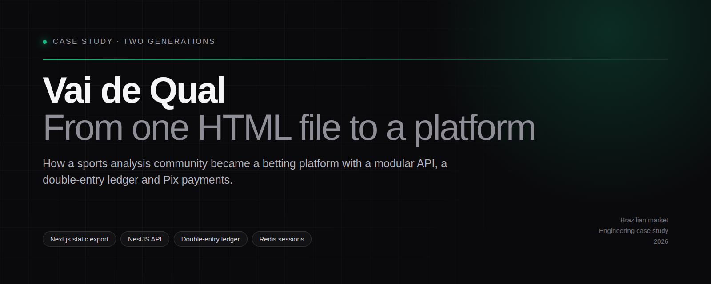
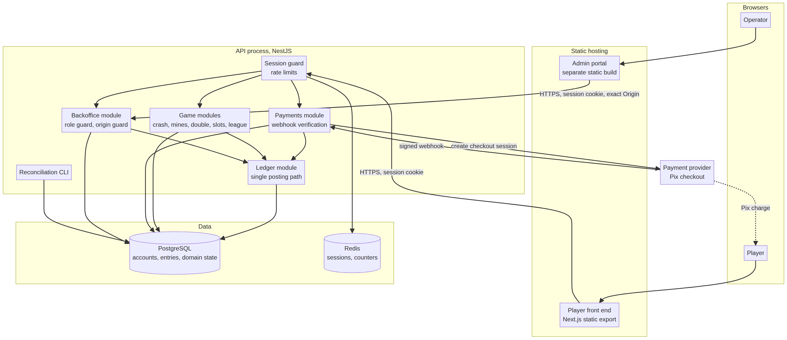
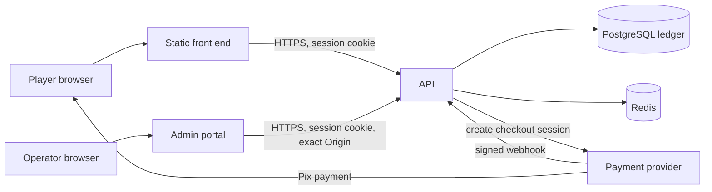

# Vai de Qual
[English](README.md) · [Português](README.pt-BR.md)

How a single-file community app became a regulated betting platform with a modular API and a double-entry ledger.



A real product for the Brazilian market, built in 2026. This repository is an engineering case study of the second generation and of the transition that produced it. It is not the product source, and it does not contain the commercial layer.

## Overview

Vai de Qual is a betting platform for the Brazilian market. Players register with a CPF (the Brazilian individual taxpayer number), pass an age check, hold a wallet funded by Pix instant payments, and play casino games or bet on a simulated football league. Money leaves the platform through a withdrawal request that an operator approves by hand. An administrative backoffice handles user blocking, manual balance adjustments, the withdrawal queue, the ledger statement and the audit log.

The brand has three repositories and two distinct products, and this document treats them as one story because that is how the work happened. The first product, shipped in August 2026, was a sports analysis community: tipsters published picks, subscribers paid for access, and the whole application was roughly 2 MB of HTML per surface backed by Cloud Functions. The second product, built in November 2026, is a regulated betting platform: a Next.js front end exported as static files, a modular NestJS API, PostgreSQL as the ledger of record, Redis for sessions and rate limits, and Stripe for Pix deposits. Between the two, a third repository established a controlled rebuild with provenance rules and a lab boundary, because the first codebase could not be trusted as a source. Production status, live traffic and revenue are not disclosed here.

## The problem

The first product put an entire application into one HTML file. Markup, styles, routing, state and business rules lived in the same document, and the server side was a set of Cloud Functions called from the browser. For a content community with paid access, that shape was cheap and it shipped.

It could not carry money, and that is the actual problem this case study is about. The first product sold subscriptions, so the only financial state was a plan flag on a user record. A betting platform needs a balance that can be spent, refunded, capped and audited, and the old shape offered nothing to build that on: no journal, no transactional boundary, no place where an invariant could live.

Three specific gaps had to be closed rather than migrated. Money had no single source of truth, because a plan flag is not a balance. Payment confirmation had no trustworthy boundary, because the browser returned from the payment page with an identifier in the URL, and a redirect is a hint, not proof. The administrative surface was a route inside the same document, protected by a client-side check, which is not an authorisation boundary at all.

So the work was not a refactor. It was building the transactional foundation the brand had never needed, while keeping the content product and its audience intact: a ledger with an invariant, a payment flow where only a verified event moves money, and a session and origin model that survives a static front end on a different host from the API.

## What the product does

**Identity and account.** Registration with CPF, full name, birth date and e-mail, unique CPF and e-mail, password hashing with argon2id, and a server-side session with a version counter so that blocking a user or logging out invalidates every device. Roles are PLAYER and ADMIN.

**Wallet and money movement.** A wallet per player with a statement derived from the ledger, Pix deposits through a hosted checkout, and withdrawals that stay pending until an operator approves or rejects them. Amounts are integers in cents end to end, serialised as strings at the API boundary, never floats.

**Games.** Four casino games (Crash, Mines, Double and Slots) and a simulated football league with a single 1X2 market. Each engine is a separate module with its own rules, its own rate limits and its own persistence, sharing only the ledger, the session guard and the round counter.

**Backoffice.** User search and blocking, manual balance adjustment with a counterpart entry, the withdrawal queue in arrival order, the global ledger statement, reconciliation output, platform configuration and an audit log written in the same transaction as the action it records.

**Fairness and verification.** Server-side randomness with a committed server seed hash per player, a monotonic nonce that never resets, a client seed the player can change, and a per-round record of the seed hash used. Historical rounds keep the protocol version they were created with.

## Architecture


The system is four runtime pieces and one external provider. The front end is a static export: no server rendering, no Node process in production, only files on a CDN with the API origin injected at build time. The API is a NestJS process with feature modules and no shared mutable state beyond its database and Redis connections.



| Component | Responsibility | Notes |
|---|---|---|
| Player front end | Screens, game animation, form validation | Next.js static export, no server runtime |
| Admin portal | Backoffice screens | Separate build target and hostname from the player app |
| API | Auth, wallet, payments, games, admin, reconciliation | NestJS, 13 feature modules, 48 HTTP routes |
| PostgreSQL | Ledger of record, product state, audit log | Prisma migrations, 22 migrations, 13 models |
| Redis | Sessions, rate limit counters, rotation counters | Guard fails closed when unavailable |
| Payment provider | Pix collection and payment events | Checkout session plus signed webhook |
| Nightly CI | Randomness distribution suites | Six suites, one million samples each |

The main flow is a deposit:

1. The front end posts an amount with a mandatory `Idempotency-Key`. The API validates the amount as an integer string and applies rate limits.
2. In one transaction, the API locks the user row, looks up the key, sums the day's deposits for the daily cap, and inserts a pending deposit. It commits before any network call.
3. The API asks the provider for a checkout session with the deposit id in metadata and a provider-side idempotency key, then persists the session id, URL and expiry.
4. The player pays the Pix charge in the provider's page. Two independent clocks run: the checkout session window and the Pix charge window. Both are 30 minutes and neither is derived from the other.
5. The provider sends a signed event. The API verifies the signature over the raw body, resolves the deposit, locks it, confirms it is still pending, posts the ledger transaction with a key derived from the session, marks it paid, and returns 200.
6. The wallet screen reads the balance from the ledger. The front-end redirect never credits anything.

## Engineering highlights

### A ledger that cannot be talked out of balance
The first product had no balance at all: paid access was a flag, so there was nothing to keep consistent. The betting platform needed the opposite discipline, and it inverts the usual shortcut: the journal is the record and the balance is a materialised projection of it. Every movement is a transaction with at least two entries on distinct accounts whose signed sum is zero, posted through one function that validates the sum, the bigint range and the accounts before writing. Player wallets are liability subaccounts whose stored balance must stay non positive, enforced by a `CHECK` constraint, so an overdraft is rejected by PostgreSQL instead of by an `if` a future handler forgets. Driver error `23514` becomes an insufficient funds error, with no silent adjustment. Balances are updated in deterministic account order to avoid deadlocks. A reconciliation job compares every materialised balance with the signed sum of its entries and reports differences without correcting them.

The trade-off is duplication: each posting pays for a row lock and an update, and the projection can drift if something writes outside the posting function, which is why reconciliation detects rather than repairs. Deriving the balance would make divergence impossible, and would cost an aggregate on the hot path of every bet.

### A deposit is credited by a signed webhook, once
The return URL from a payment provider is a hint, not proof: only a signed webhook can move money. The deposit row is committed before the checkout session is requested, so a provider timeout cannot leave a session with no local record. The `Idempotency-Key` header is mandatory and uniquely indexed: the same key and payload returns the original deposit, the same key with a different payload is a conflict, and a collision during the insert race produces a retryable error. The webhook verifies the signature against the raw body, resolves the deposit from metadata or session id, locks the user and the deposit, rechecks that the status is still pending, posts the ledger transaction with a key derived from the session, and only then marks it paid. Replays are absorbed by that ledger key.

The trade-off is latency and an operational dependency. A deposit stays pending until an event arrives, so a webhook that is never delivered leaves the money in limbo until reconciliation, and the API needs a reachable endpoint and a signing secret per environment. Crediting from the redirect would be faster, and it would also be a way to mint balance without payment.

### Session and origin model for a static front end
A static front end on one host, an API on another, an admin portal on a third and a public API reachable from anywhere punish sloppy defaults. Sessions are 32-byte tokens in an `HttpOnly`, `Secure`, `SameSite=Lax` cookie, stored server side in Redis with a version counter, so a block or a logout invalidates every device. CORS uses an exact origin allowlist with credentials, never a wildcard or a suffix match. Admin routes require the ADMIN role and an `Origin` header equal to the configured admin origin, on reads and writes, so another origin cannot drive the backoffice with a stolen cookie. The guard fails closed when Redis is unavailable, turning an outage into a 503 instead of an open door. Game mutations also carry the user id the client believes it has, and a mismatch returns a conflict instead of applying the action to another tab's identity.

The trade-off is friction. Exact origins break preview deployments and deep links that need a bounce through the allowlisted host, and the origin header is a browser convention, not a secret, so the guard is defence in depth. The alternative, wildcard CORS with client-side admin checks, is what the first generation had.

### Rebuilding with provenance instead of copy and paste

The first generation's deployed bundles could not be mapped back to a commit with confidence, which is a bad place to be in a domain where an operator has to explain where a rule came from. The rebuild repository therefore started almost empty and treated every candidate file as unproven until its origin, commit, hash, classification and reuse reason were recorded. Components whose exact source could not be established stayed labelled unproven and outside the active path, and the historical repository was preserved untouched as reference rather than used as a source. The foundation was 24 files and 15 commits of governance, structure and boundary documents before any feature code existed. The current generation was then written against that boundary, with the game engines, the ledger and the payment flow as separate modules.

The trade-off is time. Provenance work delays the first feature, leaves usable code unused, and forces rewrites of logic that probably worked. It also creates documentation that has to be maintained. What it buys is a codebase where every rule has an owner and an origin, which is the difference between inheriting a system and inheriting a rumour.

## Tech stack

| Layer | Choice | Why |
|---|---|---|
| Front end | Next.js 16 with static export | React routing and build tooling without a server runtime to patch and pay for |
| Styling | Tailwind CSS 4 | Design tokens in the markup, no separate stylesheet to drift |
| API | NestJS 12 on Node 20+ | Modules, guards and dependency injection make boundaries explicit in a codebase with many actors |
| Data access | Prisma 7 with the PostgreSQL adapter | Typed queries plus a migration history that can be reviewed |
| Database | PostgreSQL 16 | Transactions, `CHECK` constraints and `bigint` arithmetic, which the ledger depends on |
| Cache and counters | Redis 7 | Server-side sessions and fixed-window rate limits with a TTL |
| Payments | Stripe Checkout with Pix | Hosted payment page, signed webhook, no card data in scope |
| Password hashing | argon2id | Memory-hard hashing with a maintained Node binding |
| Validation | zod | One schema per boundary, parsed rather than trusted |
| Hosting | Static hosting for the front end, container host for the API | Two deployables with different release cadence |
| Tests | node:test with integration suites against real PostgreSQL and Redis | Tests the constraints, not a mock of them |

## By the numbers

| Metric | Betting platform | Community product | Rebuild foundation |
|---|---|---|---|
| Files | 360 | 280 | 24 |
| Lines | ~52,000 | ~55,000 | not applicable |
| Commits | 67 | 135 | 15 |
| Test files | 22 | not disclosed | not applicable |
| HTTP routes | 48 | not disclosed | none |
| Prisma models | 13 | not applicable | none |
| Migrations | 22 | not applicable | none |
| NestJS modules | 13 | not applicable | none |
| API runtime dependencies | 11 | not disclosed | none |

The API source is about 12,300 lines of TypeScript and the test suites about 14,300 lines. Six randomness suites run one million samples each on a nightly schedule.

## Security and privacy

Implemented: argon2id password hashing with a dummy verification on unknown accounts to avoid a timing oracle; opaque server-side sessions with a version counter; `HttpOnly`, `Secure`, `SameSite=Lax` cookies; exact origin allowlists for CORS and for admin routes; role guards on every admin controller; mandatory idempotency keys on money and game mutations; rate limits per IP and per user on authentication, deposits, withdrawals and each game; signature verification on the payment webhook; ledger idempotency keys on every posting; `CHECK` constraints for wallet signs and round state; a reconciliation CLI that reports divergence without repairing it; and an audit log written in the same transaction as the administrative action it records.

Not guaranteed: the origin header is a browser convention and not an authentication factor, so the admin origin guard assumes the browser enforces it and does not survive a client that lies. Rate limits are fixed windows in Redis and fail closed, which means an outage rejects traffic rather than allowing it, and a distributed attacker with many addresses is bounded only by the per-user counters. There is no multi-factor authentication, no device binding and no anomaly detection. Withdrawal approval is a human decision with an audit trail, not a fraud model. Backups, restore drills and provider-side risk are operational concerns that the application cannot enforce. A full threat model, including the limits above, is in [docs/SECURITY.md](docs/SECURITY.md).

## Scope of this repository

Published: this document, the architecture and security descriptions, the decision records, the case study, three rewritten examples that illustrate techniques with generic names, and the Mermaid sources for both diagrams.

Deliberately omitted: the product source code, the database schema, the game mathematics, the return and margin parameters, the odds and payout formulas, the bonus and rollover rules, the limit values, provider credentials, internal hostnames and project identifiers, player data, and the internal security and staging reports. The commercial layer is omitted as a whole rather than redacted field by field, because a partially redacted rule set is still a rule set. The betting parameters are the part of this product that is commercially sensitive and, in a regulated domain, also the part with the most direct incentive to be copied without the controls around it.

What remains is the engineering: how money is recorded, how a payment becomes a balance, how a session is trusted, and what it cost to carry a product from a single HTML file to a transactional platform.

## Repository map

```
.
├── README.md
├── LICENSE
├── .gitignore
├── docs
│   ├── ARCHITECTURE.md      components, boundaries, data model, limits
│   ├── DECISIONS.md         seven architecture decision records
│   ├── CASE-STUDY.md        the migration story
│   └── SECURITY.md          assets, trust boundaries, controls, gaps
├── diagrams
│   ├── architecture.mmd     component diagram (Mermaid)
│   ├── architecture.png
│   ├── flow.mmd             deposit sequence (Mermaid)
│   └── flow.png
└── examples
    ├── README.md            what each example shows and how to run it
    ├── double_entry_posting.sql
    ├── idempotent_deposit.ts
    └── origin_guard.ts
```

## Documentation

- [Architecture](docs/ARCHITECTURE.md)
- [Decisions](docs/DECISIONS.md)
- [Case study](docs/CASE-STUDY.md)
- [Security and privacy](docs/SECURITY.md)
- [Português](README.pt-BR.md)

## Author

Hay Beaumont, software engineer, [github.com/yahbeaumont](https://github.com/yahbeaumont).
