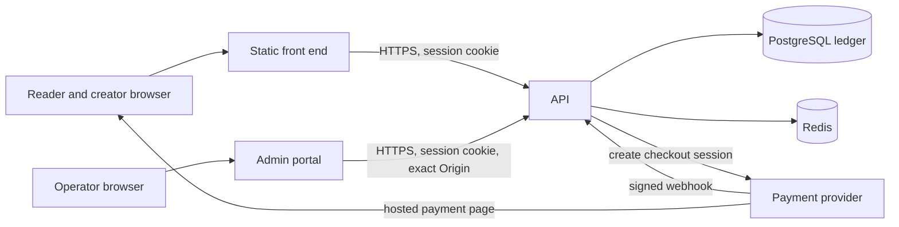

# Vai de Qual
[English](README.md) · [Português](README.pt-BR.md)

How a single-file football community app became a modular platform with paid plans, creator payouts and a double-entry ledger.


A real product for the Brazilian market, built in 2026. This repository is an engineering case study of the second generation and of the transition that produced it. It is not the product source, and it does not contain the commercial layer.

## Overview

Vai de Qual is a football community platform for the Brazilian market. Fans and analysts create profiles, publish posts and match analysis, comment on each other's work, follow the people they read, save items for later and receive notifications. Part of the content sits behind paid plans, single items can be bought with credits, and creators receive a share of what their content generates. An administrative backoffice handles moderation, account blocking and the financial record. The money layer records subscriptions, credits and creator payouts.

The brand has three repositories and two generations of one product, and this document treats them as one story because that is how the work happened. The first generation, shipped in August 2026, put the whole community into one HTML file per surface, about 2 MB each, with the rules inside the document and Cloud Functions called from the browser. The second generation, built in November 2026, is a Next.js front end exported as static files, a modular NestJS API, PostgreSQL as the ledger of record, Redis for sessions and rate limits, Stripe for plan and credit payments, and a backoffice that runs as its own security zone. Before the second generation, a third repository established a controlled rebuild with provenance rules, because the first codebase could not be trusted as a source. Production status, live traffic and revenue are not disclosed here.

## The problem

The first generation put an entire application into one HTML file per surface. Markup, styles, routing, state and business rules lived in the same document, and the server side was a set of Cloud Functions called from the browser. For a content community with paid access, that shape was cheap and it shipped.

It could not carry money, and that is the actual problem this case study is about. Paid access was a boolean on the user record, so the only financial state was a flag. A community that sells plans, sells credits and pays creators needs a record that can be spent, refunded, reconciled and audited, and the old shape offered nothing to build that on: no journal, no transactional boundary, no place where an invariant could live.

Three specific gaps had to be closed rather than migrated. Money had no single source of truth, because a flag is not a balance. Payment confirmation had no trustworthy boundary, because the browser returned from the payment page with an identifier in the URL, and a redirect is a hint, not proof. The administrative surface was a route inside the same document, protected by a client-side check, which is not an authorisation boundary at all.

So the work was not a refactor. It was building the financial and access layer the product had never needed, while keeping the community and its audience intact: a ledger with an invariant, a purchase flow where only a verified event grants access, an entitlement with a period instead of a flag, and a session and origin model that survives a static front end on a different host from the API.

## What the product does

**Identity and account.** Registration with e-mail, name and birth date, a unique e-mail, password hashing with argon2id, and a server-side session with a version counter so that blocking an account or logging out invalidates every device. Roles are USER and ADMIN. A profile carries a handle, a display name and a short bio. Privacy settings decide whether the profile and its posts are visible to people who do not follow it, and account status is separate from role, so a blocked account keeps its data and loses access.

**Community.** Posts with match analysis, comments on posts, follows, saved and archived items, notifications and content preferences. The feed is read from the social graph at request time with keyset pagination, so a new follow appears on the next page instead of waiting for a background job.

**Plans, credits and premium content.** A paid plan grants an entitlement with a period, and premium posts and creator pages check that record on every read. Credits are bought in packs and spent on single premium items. Spending a credit is a ledger posting, not a decrement of a counter. A plan purchase and its entitlement are written in the same transaction, so a payment cannot exist without the access it paid for.

**Creator payouts.** A creator's share is recorded as a liability as the content earns, and paid out in a batch that an operator approves. Every payout is a posting with a key, and a reversal is another posting, never an edit.

**Moderation and backoffice.** A report queue, content removal with a reason, account blocking, plan and entitlement inspection, payout approval, the global ledger statement, reconciliation output and an audit log written in the same transaction as the action it records.

**Money movement.** Amounts are integers in cents end to end, serialised as strings at the API boundary, never floats.

## Architecture


The system is four runtime pieces and one external provider. The front end is a static export: no server rendering, no Node process in production, only files on a CDN with the API origin injected at build time. The API is a NestJS process with feature modules and no shared mutable state beyond its database and Redis connections.



| Component | Responsibility | Notes |
|---|---|---|
| Community front end | Screens, editor, feed rendering, form validation | Next.js static export, no server runtime |
| Admin portal | Backoffice screens | Separate build target and hostname from the community app |
| API | Auth, profiles, content, plans, credits, payouts, administration, reconciliation | NestJS feature modules |
| PostgreSQL | Ledger of record, product state, audit log | Prisma migrations |
| Redis | Sessions, rate limit counters, notification counters | Guard fails closed when unavailable |
| Payment provider | Plan and credit collection, payment events | Checkout session plus signed webhook |
| Reconciliation job | Materialised balance against the journal | Scheduled CLI entry point, reports and never repairs |

The main flow is a plan purchase:

1. The front end posts the plan with a mandatory `Idempotency-Key`. The API validates the payload with zod and applies rate limits per IP and per user.
2. In one transaction, the API locks the user row, looks up the key and inserts a pending purchase, then commits. The commit happens before any network call.
3. The API asks the provider for a checkout session with the purchase id in metadata and a provider-side idempotency key, then persists the session id, URL and expiry.
4. The buyer pays on the provider's page and returns to the front end. The return URL only triggers a refresh.
5. The provider sends a signed event. The API verifies the signature over the raw body, resolves the purchase, locks it, confirms it is still pending, posts the ledger transaction with a key derived from the session, marks the purchase paid and writes the entitlement, all in one transaction, and returns 200.
6. The account screen reads access from the entitlement and the credit balance from the ledger. The front-end redirect never grants anything.

## Engineering highlights

### A ledger that cannot be talked out of balance
The first product had no balance at all: paid access was a flag, so there was nothing to keep consistent. The community needed the opposite discipline, and it inverts the usual shortcut: the journal is the record and the balance is a materialised projection of it. Every movement is a transaction with at least two entries on distinct accounts whose signed sum is zero, posted through one function that validates the sum, the bigint range and the accounts before writing. User credit accounts are liability subaccounts whose stored balance must stay non positive, enforced by a `CHECK` constraint, so an overdraw is rejected by PostgreSQL instead of by an `if` a future handler forgets. Driver error `23514` becomes an insufficient funds error, with no silent adjustment. Balances are updated in a fixed account order to avoid deadlocks. A reconciliation job compares every materialised balance with the signed sum of its entries and reports differences without correcting them.

The trade-off is duplication: each posting pays for a row lock and an update, and the projection can drift if something writes outside the posting function, which is why reconciliation detects rather than repairs. Deriving the balance would make divergence impossible, and would cost an aggregate on the hot path of every purchase and every premium read.

### A purchase is confirmed by a signed webhook, once
The return URL from a payment provider is a hint, not proof: only a signed webhook can grant access. The purchase row is committed before the checkout session is requested, so a provider timeout cannot leave a session with no local record. The `Idempotency-Key` header is mandatory and uniquely indexed: the same key and payload returns the original purchase, the same key with a different payload is a conflict, and a collision during the insert race produces a retryable error. The webhook verifies the signature against the raw body, resolves the purchase from metadata or session id, locks the user and the purchase, rechecks that the status is still pending, posts the ledger transaction with a key derived from the session, and only then marks it paid and writes the entitlement. Replays are absorbed by that ledger key.

The trade-off is latency and an operational dependency. A purchase stays pending until an event arrives, so a webhook that is never delivered leaves a buyer without access until reconciliation, and the API needs a reachable endpoint and a signing secret per environment. Granting access from the redirect would be faster, and it would also be a way to give away paid content without a payment.

### Session and origin model for a static front end
A static front end on one host, an API on another, an admin portal on a third and a public API reachable from anywhere punish sloppy defaults. Sessions are 32-byte tokens in an `HttpOnly`, `Secure`, `SameSite=Lax` cookie, stored server side in Redis with a version counter, so a block or a logout invalidates every device. CORS uses an exact origin allowlist with credentials, never a wildcard or a suffix match. Admin routes require the ADMIN role and an `Origin` header equal to the configured admin origin, on reads and writes, so another origin cannot drive the backoffice with a stolen cookie. The guard fails closed when Redis is unavailable, turning an outage into a 503 instead of an open door. Content and payment mutations also carry the user id the client believes it has, and a mismatch returns a conflict instead of applying the action to another tab's identity.

The trade-off is friction. Exact origins break preview deployments and deep links that need a bounce through the allowlisted host, and the origin header is a browser convention, not a secret, so the guard is defence in depth. The alternative, wildcard CORS with client-side admin checks, is what the first generation had.

### Rebuilding with provenance instead of copy and paste

The first generation's deployed bundles could not be mapped back to a commit with confidence, which is a bad place to be when a rule decides whether a payment grants access to content. The rebuild repository therefore started almost empty and treated every candidate file as unproven until its origin, commit, hash, classification and reuse reason were recorded. Components whose exact source could not be established stayed labelled unproven and outside the active path, and the historical repository was preserved untouched as reference rather than used as a source. The foundation was 24 files and 15 commits of governance, structure and boundary documents before any feature code existed. The current generation was then written against that boundary, with the ledger, the entitlement model, the payment flow and the payout path as separate modules.

The trade-off is time. Provenance work delays the first feature, leaves usable code unused, and forces rewrites of logic that probably worked. It also creates documentation that has to be maintained. What it buys is a codebase where every rule has an owner and an origin, rather than a codebase where every rule is a rumour.

## Tech stack

| Layer | Choice | Why |
|---|---|---|
| Front end | Next.js 16 with static export | React routing and build tooling without a server runtime to patch and pay for |
| Styling | Tailwind CSS 4 | Design tokens in the markup, no separate stylesheet to drift |
| API | NestJS 12 on Node 20+ | Modules, guards and dependency injection make boundaries explicit in a codebase with many actors |
| Data access | Prisma 7 with the PostgreSQL adapter | Typed queries plus a migration history that can be reviewed |
| Database | PostgreSQL 16 | Transactions, `CHECK` constraints and `bigint` arithmetic, which the ledger depends on |
| Cache and counters | Redis 7 | Server-side sessions and fixed-window rate limits with a TTL |
| Payments | Stripe Checkout | Hosted payment page, signed webhook, no card data in scope |
| Password hashing | argon2id | Memory-hard hashing with a maintained Node binding |
| Validation | zod | One schema per boundary, parsed rather than trusted |
| Hosting | Static hosting for the front end, container host for the API | Two deployables with different release cadence |
| Tests | node:test with integration suites against real PostgreSQL and Redis | Tests the constraints, not a mock of them |

## By the numbers

| Generation | Period | Files | Lines | Commits |
|---|---|---|---|---|
| First generation | August 2026 | 280 | about 55,000 | 135 |
| Rebuild foundation | October 2026 | 24 | not applicable | 15 |
| Second generation | November 2026 | not disclosed here | not disclosed here | not disclosed here |

Each surface of the first generation was about 2 MB of HTML, because markup, styles, routing and rules shared a single document. The second generation ships a build artefact instead of a document, and its internal metrics are not published in this repository.

## Security and privacy

Implemented: argon2id password hashing with a dummy verification on unknown accounts to avoid a timing oracle; opaque server-side sessions with a version counter; `HttpOnly`, `Secure`, `SameSite=Lax` cookies; exact origin allowlists for CORS and for admin routes; role guards on every admin controller; mandatory idempotency keys on purchases, credit redemptions and payouts; rate limits per IP and per user on authentication, publishing, commenting, checkout and payout approval; signature verification on the payment webhook; entitlement checks on every premium read, resolved on the server and never trusted from the client; ledger idempotency keys on every posting; `CHECK` constraints for credit account signs, entitlement periods and purchase states; a reconciliation CLI that reports divergence without repairing it; and an audit log written in the same transaction as the administrative action it records.

Not guaranteed: the origin header is a browser convention and not an authentication factor, so the admin origin guard assumes the browser enforces it and does not survive a client that lies. Rate limits are fixed windows in Redis and fail closed, which means an outage rejects traffic rather than allowing it, and a distributed attacker with many addresses is bounded only by the per-user counters. There is no multi-factor authentication, no device binding and no anomaly detection. Moderation is a policy plus human review, so its consistency is the consistency of the policy. Payout approval is a human decision with an audit trail, not a fraud model. Backups, restore drills and provider-side risk are operational concerns that the application cannot enforce. A full threat model, including the limits above, is in [docs/SECURITY.md](docs/SECURITY.md).

## Scope of this repository

Published: this document, the architecture and security descriptions, the decision records, the case study, three rewritten examples that illustrate techniques with generic names, and the Mermaid sources for both diagrams.

Deliberately omitted: the product source code, the database schema, the plan catalogue and its prices, the entitlement rules that decide what each plan unlocks, the creator share calculation, the moderation policy text, the limit values, provider credentials, internal hostnames and project identifiers, account data, and the internal security and staging reports. The commercial layer is omitted as a whole rather than redacted field by field, because a partially redacted rule set is still a rule set. The plan and payout rules are the part of this product that is commercially sensitive and the part with the most direct incentive to be copied without the controls around it.

What remains is the engineering: how money is recorded, how a payment becomes access, how a session is trusted, and what it cost to carry a product from a single HTML file to a transactional platform.

## Repository map

```
.
├── README.md
├── LICENSE
├── .gitignore
├── docs
│   ├── ARCHITECTURE.md      components, boundaries, data model, limits
│   ├── DECISIONS.md         seven architecture decision records
│   ├── CASE-STUDY.md        the migration story
│   └── SECURITY.md          assets, trust boundaries, controls, gaps
├── diagrams
│   ├── architecture.mmd     component diagram (Mermaid)
│   ├── architecture.png
│   ├── flow.mmd             plan purchase sequence (Mermaid)
│   └── flow.png
└── examples
    ├── README.md            what each example shows and how to run it
    ├── double_entry_posting.sql
    ├── idempotent_payment.ts
    └── origin_guard.ts
```

## Documentation

- [Architecture](docs/ARCHITECTURE.md)
- [Decisions](docs/DECISIONS.md)
- [Case study](docs/CASE-STUDY.md)
- [Security and privacy](docs/SECURITY.md)
- [Português](README.pt-BR.md)

## Author

Hay Beaumont, software engineer, [github.com/yahbeaumont](https://github.com/yahbeaumont).
