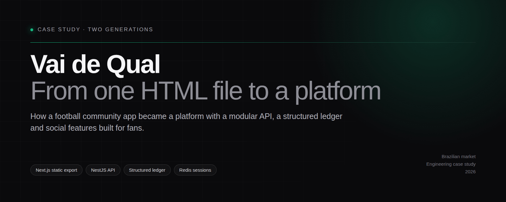
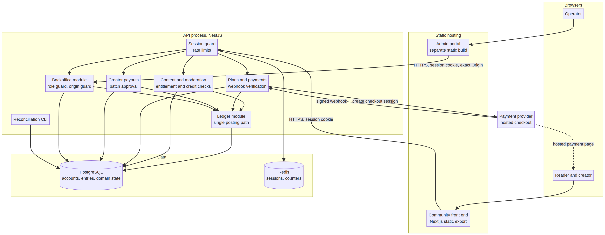
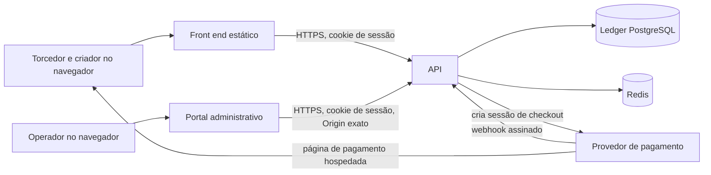

# Vai de Qual
[English](README.md) · **Português**

Como um app de comunidade de futebol em arquivo único virou uma plataforma modular, com planos pagos, repasses a criadores e um ledger de partidas dobradas.



Um produto real para o mercado brasileiro, construído em 2026. Este repositório é um estudo de caso de engenharia da segunda geração e da transição que a produziu. Não é o código do produto e não traz a camada comercial.

## Visão geral

Vai de Qual é uma plataforma de comunidade de futebol para o mercado brasileiro. Torcedores e analistas criam perfis, publicam posts e análises de partida, comentam o trabalho uns dos outros, seguem quem costumam ler, salvam itens para depois e recebem notificações. Parte do conteúdo fica atrás de planos pagos, itens avulsos podem ser comprados com créditos, e criadores recebem uma fatia do que o seu conteúdo gera. Um backoffice administrativo cuida da moderação, do bloqueio de contas e do registro financeiro. A camada de dinheiro registra assinaturas, créditos e repasses a criadores.

A marca tem três repositórios e duas gerações de um produto só, e este documento conta tudo como uma história, porque foi assim que o trabalho aconteceu. A primeira geração, entregue em agosto de 2026, colocava a comunidade inteira em um arquivo HTML por superfície, cerca de 2 MB cada, com as regras dentro do documento e Cloud Functions chamadas pelo navegador. A segunda geração, construída em novembro de 2026, é um front end Next.js exportado como arquivos estáticos, uma API NestJS modular, PostgreSQL como ledger de registro, Redis para sessões e rate limits, Stripe para pagamento de planos e créditos, e um backoffice que roda como zona de segurança própria. Antes dela, um terceiro repositório estabeleceu uma reconstrução controlada com regras de proveniência, porque o primeiro código não dava para tratar como fonte. Status em produção, tráfego real e receita não são divulgados aqui.

## O problema

A primeira geração colocava uma aplicação inteira em um arquivo HTML por superfície. Marcação, estilos, roteamento, estado e regras de negócio moravam no mesmo documento, e o servidor era um conjunto de Cloud Functions chamadas pelo navegador. Para uma comunidade de conteúdo com acesso pago, esse formato saía barato e chegou ao ar.

O que ele não fazia era carregar dinheiro, e é desse problema que este estudo de caso trata. Acesso pago era um booleano no registro do usuário, então o único estado financeiro era uma flag. Uma comunidade que vende planos, vende créditos e paga criadores precisa de um registro que dê para gastar, estornar, reconciliar e auditar. O formato antigo não oferecia base para isso: nenhum diário, nenhuma fronteira transacional, nenhum lugar onde uma invariante pudesse morar.

Três lacunas precisavam ser fechadas, não migradas. O dinheiro não tinha fonte única de verdade, porque flag não é saldo. A confirmação de pagamento não tinha fronteira confiável, porque o navegador voltava da página de pagamento com um identificador na URL, e redirecionamento é pista, não prova. A superfície administrativa era uma rota dentro do mesmo documento, protegida por uma checagem no cliente, o que não é fronteira de autorização em nenhum sentido.

O trabalho, portanto, não foi um refactor. Foi construir a camada financeira e de acesso de que o produto nunca tinha precisado, com a comunidade e sua audiência intactas: um ledger com invariante, um fluxo de compra em que só um evento verificado libera acesso, um entitlement com período no lugar de uma flag, e um modelo de sessão e origem que aguenta um front end estático em host diferente do da API.

## O que o produto faz

**Identidade e conta.** Cadastro com e-mail, nome e data de nascimento, e-mail único, hash de senha com argon2id e sessão no servidor com contador de versão, de modo que bloquear uma conta ou sair invalide todos os dispositivos. Os papéis são USER e ADMIN. O perfil carrega um handle, um nome de exibição e uma bio curta. As configurações de privacidade decidem se o perfil e as suas publicações aparecem para quem não o segue, e o status da conta é separado do papel: uma conta bloqueada mantém os dados e perde o acesso.

**Comunidade.** Publicações com análise de partida, comentários, seguidores, itens salvos e arquivados, notificações e preferências de conteúdo. O feed é lido do grafo social na hora da requisição, com paginação por keyset, então quem passou a seguir aparece já na página seguinte, sem esperar um job em background.

**Planos, créditos e conteúdo premium.** Um plano pago concede um entitlement com período, e publicações premium e páginas de criador consultam esse registro em toda leitura. Créditos são comprados em pacotes e gastos em itens premium avulsos. Gastar um crédito é um lançamento no ledger, não o decremento de um contador. A compra do plano e o entitlement são gravados na mesma transação, então um pagamento não existe sem o acesso que ele pagou.

**Repasses a criadores.** A fatia do criador entra como passivo conforme o conteúdo rende, e é paga em um lote que um operador aprova. Todo repasse é um lançamento com chave, e um estorno é outro lançamento, nunca uma edição.

**Moderação e backoffice.** Fila de denúncias, remoção de conteúdo com motivo, bloqueio de conta, inspeção de planos e entitlements, aprovação de repasses, o extrato global do ledger, a saída da reconciliação e um log de auditoria escrito na mesma transação da ação que ele registra.

**Movimentação de dinheiro.** Valores são inteiros em centavos de ponta a ponta, serializados como string na fronteira da API, nunca float.

## Arquitetura


O sistema tem quatro peças em runtime e um provedor externo. O front end é uma exportação estática: sem renderização no servidor, sem processo Node em produção, só arquivos em CDN com a origem da API injetada em tempo de build. A API é um processo NestJS com módulos de funcionalidade e nenhum estado mutável compartilhado além das conexões com o banco e com o Redis.



| Componente | Responsabilidade | Observações |
|---|---|---|
| Front end da comunidade | Telas, editor, renderização do feed, validação de formulário | Exportação estática do Next.js, sem runtime de servidor |
| Portal administrativo | Telas de backoffice | Alvo de build e hostname separados do app da comunidade |
| API | Autenticação, perfis, conteúdo, planos, créditos, repasses, administração, reconciliação | Módulos de funcionalidade do NestJS |
| PostgreSQL | Ledger de registro, estado do produto, log de auditoria | Migrations do Prisma |
| Redis | Sessões, contadores de rate limit, contadores de notificação | O guard falha fechado quando o serviço cai |
| Provedor de pagamento | Cobrança de planos e de créditos, eventos de pagamento | Sessão de checkout mais webhook assinado |
| Job de reconciliação | Saldo materializado contra o diário | Entry point de CLI agendado, reporta e nunca corrige |

O fluxo principal é a compra de um plano:

1. O front end envia o plano com um `Idempotency-Key` obrigatório. A API valida o payload com zod e aplica rate limits por IP e por usuário.
2. Em uma transação, a API bloqueia a linha do usuário, procura a chave e insere uma compra pendente, depois faz commit. O commit vem antes de qualquer chamada de rede.
3. A API pede ao provedor uma sessão de checkout com o id da compra nos metadados e uma idempotency key do lado do provedor, e grava o id da sessão, a URL e a expiração.
4. O comprador paga na página do provedor e volta para o front end. A URL de retorno só aciona um refresh.
5. O provedor envia um evento assinado. A API confere a assinatura sobre o corpo bruto, resolve a compra, a bloqueia, confirma que ela continua pendente, lança a transação no ledger com uma chave derivada da sessão, marca a compra como paga e grava o entitlement, tudo em uma transação, e responde 200.
6. A tela da conta lê o acesso no entitlement e o saldo de créditos no ledger. O redirecionamento do front end nunca concede nada.

## Destaques de engenharia

### Um ledger que não se deixa desbalancear
O primeiro produto não tinha saldo nenhum: acesso pago era uma flag, então não havia nada para manter consistente. A comunidade precisava da disciplina oposta, e ela inverte o atalho usual: o diário é o registro, e o saldo é uma projeção materializada dele. Cada movimentação é uma transação com pelo menos dois lançamentos em contas distintas cuja soma com sinal é zero, lançada por uma única função que valida a soma, o intervalo do bigint e as contas antes de escrever. Contas de crédito do usuário são subcontas de passivo, e o saldo armazenado não pode ficar positivo: quem garante é uma constraint `CHECK`, então um estouro é rejeitado pelo PostgreSQL e não por um `if` que um handler futuro esquece. O erro `23514` do driver vira erro de saldo insuficiente, sem ajuste silencioso. Os saldos são atualizados em ordem fixa de conta para evitar deadlock. Um job de reconciliação compara cada saldo materializado com a soma com sinal dos seus lançamentos e reporta diferenças sem corrigi-las.

O trade-off é duplicação: cada lançamento paga por um row lock e um update, e a projeção pode divergir se algo escrever fora da função de lançamento. É por isso que a reconciliação detecta em vez de reparar. Derivar o saldo tornaria a divergência impossível, ao custo de uma agregação no caminho quente de cada compra e de cada leitura premium.

### Uma compra é confirmada por um webhook assinado, uma vez
A URL de retorno de um provedor de pagamento é pista, não prova: só um webhook assinado concede acesso. A linha da compra é commitada antes de a sessão de checkout ser pedida, então um timeout do provedor não deixa sessão sem registro local. O header `Idempotency-Key` é obrigatório e tem índice único: a mesma chave com o mesmo payload devolve a compra original, a mesma chave com payload diferente é conflito, e uma colisão na corrida de inserção gera um erro retentável. O webhook verifica a assinatura contra o corpo bruto, resolve a compra pelos metadados ou pelo id da sessão, bloqueia o usuário e a compra, reconfere que o status ainda é pendente, lança a transação no ledger com uma chave derivada da sessão, e só então marca a compra como paga e grava o entitlement. Replays morrem nessa chave do ledger.

O trade-off é latência e uma dependência operacional. A compra fica pendente até um evento chegar, então um webhook que nunca é entregue deixa o comprador sem acesso até a reconciliação, e a API precisa de um endpoint alcançável e de um segredo de assinatura por ambiente. Conceder acesso pelo redirecionamento seria mais rápido, e também seria um jeito de entregar conteúdo pago sem pagamento.

### Modelo de sessão e origem para um front end estático
Um front end estático em um host, uma API em outro, um portal administrativo em um terceiro e uma API pública alcançável de qualquer lugar não perdoam descuido na configuração. As sessões são tokens de 32 bytes em cookie `HttpOnly`, `Secure`, `SameSite=Lax`, guardados no servidor em Redis com um contador de versão, então um bloqueio ou um logout invalida todos os dispositivos. O CORS usa allowlist exata de origem com credenciais, nunca wildcard nem correspondência por sufixo. As rotas de admin exigem o papel ADMIN e um header `Origin` igual à origem de admin configurada, em leitura e em escrita, para que outra origem não opere o backoffice com um cookie roubado. O guard falha fechado quando o Redis cai, o que transforma indisponibilidade em 503 e não em porta aberta. As mutações de conteúdo e de pagamento também carregam o id de usuário que o cliente acredita ter, e uma divergência devolve conflito em vez de aplicar a ação à identidade de outra aba.

O trade-off é atrito. Origem exata quebra deploy de preview e deep link que precise dar a volta pelo host da allowlist, e o header de origem é convenção de navegador, não segredo, então o guard é defesa em profundidade. A alternativa, CORS com wildcard e checagem de admin no cliente, é o que a primeira geração tinha.

### Reconstruir com proveniência em vez de copiar e colar

Os bundles publicados da primeira geração não voltavam para um commit com confiança, e isso é um lugar ruim quando uma regra decide se um pagamento libera conteúdo. Por isso o repositório de reconstrução começou quase vazio e tratou cada arquivo candidato como não comprovado até registrar origem, commit, hash, classificação e motivo de reuso. Componente cuja origem exata não dava para estabelecer continuou rotulado como não comprovado e fora do caminho ativo, e o repositório histórico ficou intacto como referência, não como fonte. A fundação foram 24 arquivos e 15 commits de governança, estrutura e documentos de fronteira antes de existir código de funcionalidade. A geração atual foi escrita contra essa fronteira, com o ledger, o modelo de entitlement, o fluxo de pagamento e o caminho de repasse como módulos separados.

O trade-off é tempo. Trabalho de proveniência atrasa a primeira funcionalidade, deixa código utilizável sem uso e força reescrita de lógica que provavelmente funcionava. Também cria documentação para manter. Em troca, cada regra passa a ter dono e origem, o que é bem diferente de uma base de código em que toda regra é boato.

## Stack de tecnologia

| Camada | Escolha | Por quê |
|---|---|---|
| Front end | Next.js 16 com exportação estática | Roteamento React e ferramentas de build sem runtime de servidor para corrigir e pagar |
| Estilo | Tailwind CSS 4 | Tokens de design na marcação, sem folha de estilo separada para divergir |
| API | NestJS 12 no Node 20+ | Módulos, guards e injeção de dependência deixam as fronteiras explícitas em uma base com muitos atores |
| Acesso a dados | Prisma 7 com o adaptador PostgreSQL | Consultas tipadas e um histórico de migrations que dá para revisar |
| Banco de dados | PostgreSQL 16 | Transações, constraints `CHECK` e aritmética `bigint`, das quais o ledger depende |
| Cache e contadores | Redis 7 | Sessões no servidor e rate limits de janela fixa com TTL |
| Pagamentos | Stripe Checkout | Página de pagamento hospedada, webhook assinado, nenhum dado de cartão no escopo |
| Hash de senha | argon2id | Hashing memory-hard com binding Node mantido |
| Validação | zod | Um schema por fronteira, interpretado em vez de confiado |
| Hospedagem | Hospedagem estática para o front end, host de contêiner para a API | Dois artefatos de deploy com cadências de release diferentes |
| Testes | node:test com suítes de integração contra PostgreSQL e Redis reais | Testa as constraints, não um mock delas |

## Em números

| Geração | Período | Arquivos | Linhas | Commits |
|---|---|---|---|---|
| Primeira geração | agosto de 2026 | 280 | cerca de 55 mil | 135 |
| Fundação da reconstrução | outubro de 2026 | 24 | não se aplica | 15 |
| Segunda geração | novembro de 2026 | não divulgado aqui | não divulgado aqui | não divulgado aqui |

Cada superfície da primeira geração tinha cerca de 2 MB de HTML, porque marcação, estilos, roteamento e regras dividiam um único documento. A segunda geração entrega um artefato de build em vez de um documento, e suas métricas internas não são publicadas neste repositório.

## Segurança e privacidade

Implementado: hash de senha com argon2id e verificação fictícia em contas desconhecidas para evitar oráculo de tempo; sessões opacas no servidor com contador de versão; cookies `HttpOnly`, `Secure`, `SameSite=Lax`; allowlists exatas de origem para CORS e para as rotas de admin; guards de papel em todo controller de admin; idempotency keys obrigatórias em compras, resgates de crédito e repasses; rate limits por IP e por usuário em autenticação, publicação, comentário, checkout e aprovação de repasse; verificação de assinatura no webhook de pagamento; checagem de entitlement em toda leitura premium, resolvida no servidor e nunca confiada ao cliente; idempotency keys do ledger em todo lançamento; constraints `CHECK` para sinal de conta de crédito, período de entitlement e estado de compra; um CLI de reconciliação que reporta divergência sem reparar; e um log de auditoria escrito na mesma transação da ação administrativa que ele registra.

Não garantido: o header de origem é convenção de navegador e não fator de autenticação, então o guard de origem de admin assume que o navegador o impõe e não sobrevive a um cliente que mente. Os rate limits são janelas fixas em Redis e falham fechados, o que significa que uma indisponibilidade rejeita tráfego em vez de liberá-lo, e um atacante distribuído com muitos endereços só é limitado pelos contadores por usuário. Não há autenticação multifator, vínculo de dispositivo nem detecção de anomalia. A moderação é política mais revisão humana, então a consistência dela é a consistência da política. A aprovação de repasse é decisão humana com trilha de auditoria, não modelo de fraude. Backups, exercícios de restore e risco do lado do provedor são preocupações operacionais que a aplicação não consegue impor. Um threat model completo, com os limites acima, está em [docs/pt-BR/SEGURANCA.md](docs/pt-BR/SEGURANCA.md).

## Escopo deste repositório

Publicado: este documento, as descrições de arquitetura e de segurança, os registros de decisão, o estudo de caso, três exemplos reescritos que ilustram técnicas com nomes genéricos, e as fontes Mermaid dos dois diagramas.

Deliberadamente omitido: o código-fonte do produto, o schema do banco de dados, o catálogo de planos e seus preços, as regras de entitlement que decidem o que cada plano libera, o cálculo da fatia do criador, o texto da política de moderação, os valores de limite, credenciais de provedores, hostnames internos e identificadores de projeto, dados de conta, e os relatórios internos de segurança e de staging. A camada comercial é omitida como um todo, e não redigida campo a campo, porque um conjunto de regras parcialmente redigido continua sendo um conjunto de regras. As regras de plano e de repasse são a parte deste produto que é comercialmente sensível e a parte com o incentivo mais direto a ser copiada sem os controles ao redor.

O que resta é a engenharia: como o dinheiro é registrado, como um pagamento vira acesso, como uma sessão é confiável, e quanto custou levar um produto de um único arquivo HTML até uma plataforma transacional.

## Mapa do repositório

```
.
├── README.md
├── LICENSE
├── .gitignore
├── docs
│   ├── ARCHITECTURE.md      components, boundaries, data model, limits
│   ├── DECISIONS.md         seven architecture decision records
│   ├── CASE-STUDY.md        the migration story
│   └── SECURITY.md          assets, trust boundaries, controls, gaps
├── diagrams
│   ├── architecture.mmd     component diagram (Mermaid)
│   ├── architecture.png
│   ├── flow.mmd             plan purchase sequence (Mermaid)
│   └── flow.png
└── examples
    ├── README.md            what each example shows and how to run it
    ├── double_entry_posting.sql
    ├── idempotent_payment.ts
    └── origin_guard.ts
```

## Documentação

- [Arquitetura](docs/pt-BR/ARQUITETURA.md)
- [Decisões](docs/pt-BR/DECISOES.md)
- [Estudo de caso](docs/pt-BR/ESTUDO-DE-CASO.md)
- [Segurança e privacidade](docs/pt-BR/SEGURANCA.md)
- [English](README.md)

## Autor

Hay Beaumont, engenheiro de software, [github.com/yahbeaumont](https://github.com/yahbeaumont).
