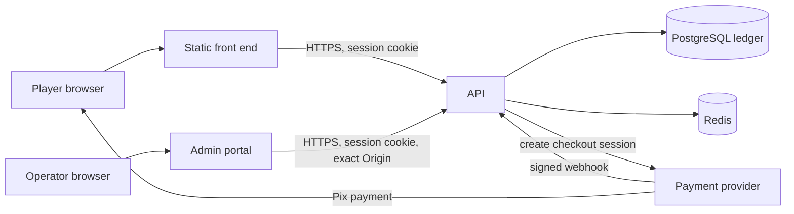

# Vai de Qual
[English](README.md) · **Português**

Como um aplicativo de comunidade em arquivo único se tornou uma plataforma de apostas regulada, com API modular e um ledger de partidas dobradas.


Um produto real para o mercado brasileiro, construído em 2026. Este repositório é um estudo de caso de engenharia da segunda geração e da transição que a produziu. Não é o código-fonte do produto e não contém a camada comercial.

## Visão geral

Vai de Qual é uma plataforma de apostas para o mercado brasileiro. Os jogadores se registram com CPF (o número de contribuinte individual brasileiro), passam por uma verificação de idade, têm uma carteira abastecida por pagamentos instantâneos Pix, e jogam jogos de cassino ou apostam em uma liga de futebol simulada. O dinheiro sai da plataforma por meio de uma solicitação de saque que um operador aprova manualmente. Um backoffice administrativo cuida do bloqueio de usuários, dos ajustes manuais de saldo, da fila de saques, do extrato do ledger e do log de auditoria.

A marca tem três repositórios e dois produtos distintos, e este documento trata os dois como uma única história, porque foi assim que o trabalho aconteceu. O primeiro produto, entregue em agosto de 2026, era uma comunidade de análise esportiva: tipsters publicavam palpites, assinantes pagavam pelo acesso, e a aplicação inteira era cerca de 2 MB de HTML por superfície, apoiada em Cloud Functions. O segundo produto, construído em novembro de 2026, é uma plataforma de apostas regulada: um front end Next.js exportado como arquivos estáticos, uma API NestJS modular, PostgreSQL como ledger de registro, Redis para sessões e rate limits, e Stripe para depósitos via Pix. Entre os dois, um terceiro repositório estabeleceu uma reconstrução controlada, com regras de proveniência e uma fronteira de laboratório, porque o primeiro código não podia ser tratado como fonte confiável. O status em produção, o tráfego real e a receita não são divulgados aqui.

## O problema

O primeiro produto colocava uma aplicação inteira em um único arquivo HTML. Marcação, estilos, roteamento, estado e regras de negócio viviam no mesmo documento, e o lado servidor era um conjunto de Cloud Functions chamadas pelo navegador. Para uma comunidade de conteúdo com acesso pago, esse formato era barato e foi entregue.

Ele não conseguia carregar dinheiro, e é sobre isso que este estudo de caso trata. O primeiro produto vendia assinaturas, então o único estado financeiro era uma flag de plano no registro do usuário. Uma plataforma de apostas precisa de um saldo que possa ser gasto, estornado, limitado e auditado, e o formato antigo não oferecia nada sobre o que construir isso: nenhum diário, nenhuma fronteira transacional, nenhum lugar onde uma invariante pudesse viver.

Três lacunas específicas tiveram de ser fechadas, e não migradas. O dinheiro não tinha uma única fonte de verdade, porque uma flag de plano não é um saldo. A confirmação de pagamento não tinha uma fronteira confiável, porque o navegador voltava da página de pagamento com um identificador na URL, e um redirecionamento é uma pista, não uma prova. A superfície administrativa era uma rota dentro do mesmo documento, protegida por uma checagem no cliente, o que não é fronteira de autorização de forma alguma.

Portanto o trabalho não foi um refactor. Foi construir a fundação transacional de que a marca nunca precisou, mantendo o produto de conteúdo e sua audiência intactos: um ledger com uma invariante, um fluxo de pagamento em que apenas um evento verificado movimenta dinheiro, e um modelo de sessão e origem que sobrevive a um front end estático em um host diferente do da API.

## O que o produto faz

**Identidade e conta.** Registro com CPF, nome completo, data de nascimento e e-mail, CPF e e-mail únicos, hash de senha com argon2id, e uma sessão no servidor com um contador de versão, para que bloquear um usuário ou fazer logout invalide todos os dispositivos. Os papéis são PLAYER e ADMIN.

**Carteira e movimentação de dinheiro.** Uma carteira por jogador com extrato derivado do ledger, depósitos via Pix por checkout hospedado, e saques que ficam pendentes até um operador aprová-los ou rejeitá-los. Os valores são inteiros em centavos de ponta a ponta, serializados como strings na fronteira da API, nunca floats.

**Jogos.** Quatro jogos de cassino (Crash, Mines, Double e Slots) e uma liga de futebol simulada com um único mercado 1X2. Cada motor é um módulo separado, com suas próprias regras, seus próprios rate limits e sua própria persistência, compartilhando apenas o ledger, o guard de sessão e o contador de rodadas.

**Backoffice.** Busca e bloqueio de usuários, ajuste manual de saldo com um lançamento de contrapartida, a fila de saques em ordem de chegada, o extrato global do ledger, a saída de reconciliação, a configuração da plataforma e um log de auditoria escrito na mesma transação da ação que ele registra.

**Justiça e verificação.** Aleatoriedade no servidor com um hash de server seed comprometido por jogador, um nonce monotônico que nunca reinicia, uma client seed que o jogador pode alterar, e um registro por rodada do hash de seed usado. Rodadas históricas mantêm a versão de protocolo com que foram criadas.

## Arquitetura


O sistema são quatro peças em runtime e um provedor externo. O front end é uma exportação estática: sem renderização no servidor, sem processo Node em produção, apenas arquivos em um CDN com a origem da API injetada em tempo de build. A API é um processo NestJS com módulos de funcionalidade e nenhum estado mutável compartilhado além de suas conexões com o banco e com o Redis.



| Componente | Responsabilidade | Observações |
|---|---|---|
| Front end do jogador | Telas, animação dos jogos, validação de formulário | Exportação estática do Next.js, sem runtime de servidor |
| Portal administrativo | Telas de backoffice | Alvo de build e hostname separados do app do jogador |
| API | Autenticação, carteira, pagamentos, jogos, admin, reconciliação | NestJS, 13 módulos de funcionalidade, 48 rotas HTTP |
| PostgreSQL | Ledger de registro, estado do produto, log de auditoria | Migrations do Prisma, 22 migrations, 13 modelos |
| Redis | Sessões, contadores de rate limit, contadores de rotação | O guard falha fechado quando o serviço está indisponível |
| Provedor de pagamento | Cobrança Pix e eventos de pagamento | Sessão de checkout mais webhook assinado |
| CI noturno | Suítes de distribuição de aleatoriedade | Seis suítes, um milhão de amostras cada |

O fluxo principal é um depósito:

1. O front end envia um valor com um `Idempotency-Key` obrigatório. A API valida o valor como string de inteiro e aplica rate limits.
2. Em uma transação, a API bloqueia a linha do usuário, procura a chave, soma os depósitos do dia para o limite diário, e insere um depósito pendente. Ela faz commit antes de qualquer chamada de rede.
3. A API pede ao provedor uma sessão de checkout com o id do depósito nos metadados e uma idempotency key do lado do provedor, e então persiste o id da sessão, a URL e a expiração.
4. O jogador paga a cobrança Pix na página do provedor. Dois relógios independentes correm: a janela da sessão de checkout e a janela da cobrança Pix. Ambas são de 30 minutos e nenhuma é derivada da outra.
5. O provedor envia um evento assinado. A API verifica a assinatura sobre o corpo bruto, resolve o depósito, o bloqueia, confirma que ele ainda está pendente, lança a transação no ledger com uma chave derivada da sessão, marca o depósito como pago, e retorna 200.
6. A tela da carteira lê o saldo do ledger. O redirecionamento do front end nunca credita nada.

## Destaques de engenharia

### Um ledger que não se deixa desbalancear
O primeiro produto não tinha saldo nenhum: o acesso pago era uma flag, então não havia nada para manter consistente. A plataforma de apostas precisava da disciplina oposta, e ela inverte o atalho usual: o diário é o registro e o saldo é uma projeção materializada dele. Cada movimentação é uma transação com pelo menos dois lançamentos em contas distintas cuja soma com sinal é zero, lançada por uma única função que valida a soma, o intervalo do bigint e as contas antes de escrever. As carteiras dos jogadores são subcontas de passivo cujo saldo armazenado deve permanecer não positivo, garantido por uma constraint `CHECK`, de modo que um overdraft é rejeitado pelo PostgreSQL em vez de por um `if` que um handler futuro esqueça. O erro `23514` do driver se torna um erro de saldo insuficiente, sem ajuste silencioso. Os saldos são atualizados em ordem determinística de conta para evitar deadlocks. Um job de reconciliação compara cada saldo materializado com a soma com sinal dos seus lançamentos e reporta as diferenças sem corrigi-las.

O trade-off é duplicação: cada lançamento paga por um row lock e um update, e a projeção pode divergir se algo escrever fora da função de lançamento, e é por isso que a reconciliação detecta em vez de reparar. Derivar o saldo tornaria a divergência impossível, e custaria uma agregação no caminho quente de cada aposta.

### Um depósito é creditado por um webhook assinado, uma vez
A URL de retorno de um provedor de pagamento é uma pista, não uma prova: apenas um webhook assinado pode movimentar dinheiro. A linha do depósito é commitada antes de a sessão de checkout ser solicitada, então um timeout do provedor não consegue deixar uma sessão sem registro local. O header `Idempotency-Key` é obrigatório e indexado de forma única: a mesma chave e o mesmo payload retornam o depósito original, a mesma chave com um payload diferente é um conflito, e uma colisão durante a corrida de inserção produz um erro retentável. O webhook verifica a assinatura contra o corpo bruto, resolve o depósito a partir dos metadados ou do id da sessão, bloqueia o usuário e o depósito, reconfere que o status ainda é pendente, lança a transação no ledger com uma chave derivada da sessão, e só então o marca como pago. Replays são absorvidos por essa chave do ledger.

O trade-off é latência e uma dependência operacional. Um depósito fica pendente até que um evento chegue, então um webhook que nunca é entregue deixa o dinheiro no limbo até a reconciliação, e a API precisa de um endpoint alcançável e de um segredo de assinatura por ambiente. Creditar a partir do redirecionamento seria mais rápido, e também seria uma forma de cunhar saldo sem pagamento.

### Modelo de sessão e origem para um front end estático
Um front end estático em um host, uma API em outro, um portal administrativo em um terceiro e uma API pública alcançável de qualquer lugar punem padrões descuidados. As sessões são tokens de 32 bytes em um cookie `HttpOnly`, `Secure`, `SameSite=Lax`, armazenados no servidor em Redis com um contador de versão, de modo que um bloqueio ou um logout invalida todos os dispositivos. O CORS usa uma allowlist exata de origens com credenciais, nunca um wildcard nem correspondência por sufixo. As rotas de admin exigem o papel ADMIN e um header `Origin` igual à origem de admin configurada, em leituras e em escritas, para que outra origem não consiga operar o backoffice com um cookie roubado. O guard falha fechado quando o Redis está indisponível, transformando uma indisponibilidade em um 503 em vez de uma porta aberta. As mutações de jogo também carregam o id de usuário que o cliente acredita ter, e uma divergência retorna um conflito em vez de aplicar a ação à identidade de outra aba.

O trade-off é atrito. Origens exatas quebram deploys de preview e deep links que precisam de um desvio pelo host que está na allowlist, e o header de origem é uma convenção do navegador, não um segredo, então o guard é defesa em profundidade. A alternativa, CORS com wildcard e checagens de admin no cliente, é o que a primeira geração tinha.

### Reconstruir com proveniência em vez de copiar e colar

Os bundles implantados da primeira geração não podiam ser mapeados de volta a um commit com confiança, o que é um lugar ruim em um domínio onde um operador precisa explicar de onde veio uma regra. O repositório de reconstrução, portanto, começou quase vazio e tratou cada arquivo candidato como não comprovado até que sua origem, commit, hash, classificação e motivo de reuso fossem registrados. Componentes cuja origem exata não pôde ser estabelecida permaneceram rotulados como não comprovados e fora do caminho ativo, e o repositório histórico foi preservado intacto como referência, em vez de usado como fonte. A fundação foram 24 arquivos e 15 commits de governança, estrutura e documentos de fronteira antes de existir qualquer código de funcionalidade. A geração atual foi então escrita contra essa fronteira, com os motores de jogo, o ledger e o fluxo de pagamento como módulos separados.

O trade-off é tempo. O trabalho de proveniência atrasa a primeira funcionalidade, deixa código utilizável sem uso, e força reescritas de lógica que provavelmente funcionava. Também cria documentação que precisa ser mantida. O que ele compra é uma base de código em que cada regra tem um dono e uma origem, que é a diferença entre herdar um sistema e herdar um boato.

## Stack de tecnologia

| Camada | Escolha | Por quê |
|---|---|---|
| Front end | Next.js 16 com exportação estática | Roteamento React e ferramentas de build sem um runtime de servidor para corrigir e pagar |
| Estilo | Tailwind CSS 4 | Tokens de design na marcação, sem folha de estilo separada para divergir |
| API | NestJS 12 no Node 20+ | Módulos, guards e injeção de dependência tornam as fronteiras explícitas em uma base de código com muitos atores |
| Acesso a dados | Prisma 7 com o adaptador PostgreSQL | Consultas tipadas mais um histórico de migrations que pode ser revisado |
| Banco de dados | PostgreSQL 16 | Transações, constraints `CHECK` e aritmética `bigint`, das quais o ledger depende |
| Cache e contadores | Redis 7 | Sessões no servidor e rate limits de janela fixa com TTL |
| Pagamentos | Stripe Checkout com Pix | Página de pagamento hospedada, webhook assinado, nenhum dado de cartão no escopo |
| Hash de senha | argon2id | Hashing memory-hard com um binding Node mantido |
| Validação | zod | Um schema por fronteira, interpretado em vez de confiado |
| Hospedagem | Hospedagem estática para o front end, host de contêiner para a API | Dois artefatos de deploy com cadências de release diferentes |
| Testes | node:test com suítes de integração contra PostgreSQL e Redis reais | Testa as constraints, não um mock delas |

## Em números

| Métrica | Plataforma de apostas | Produto de comunidade | Fundação da reconstrução |
|---|---|---|---|
| Arquivos | 360 | 280 | 24 |
| Linhas | ~52,000 | ~55,000 | não se aplica |
| Commits | 67 | 135 | 15 |
| Arquivos de teste | 22 | não divulgado | não se aplica |
| Rotas HTTP | 48 | não divulgado | nenhuma |
| Modelos Prisma | 13 | não se aplica | nenhum |
| Migrations | 22 | não se aplica | nenhuma |
| Módulos NestJS | 13 | não se aplica | nenhum |
| Dependências de runtime da API | 11 | não divulgado | nenhuma |

O código-fonte da API tem cerca de 12,300 linhas de TypeScript e as suítes de teste cerca de 14,300 linhas. Seis suítes de aleatoriedade rodam um milhão de amostras cada, em uma agenda noturna.

## Segurança e privacidade

Implementado: hash de senha com argon2id e uma verificação fictícia em contas desconhecidas para evitar um oráculo de tempo; sessões opacas no servidor com um contador de versão; cookies `HttpOnly`, `Secure`, `SameSite=Lax`; allowlists exatas de origem para CORS e para as rotas de admin; guards de papel em todo controller de admin; idempotency keys obrigatórias em mutações de dinheiro e de jogo; rate limits por IP e por usuário em autenticação, depósitos, saques e em cada jogo; verificação de assinatura no webhook de pagamento; idempotency keys do ledger em todo lançamento; constraints `CHECK` para sinais de carteira e estado de rodada; um CLI de reconciliação que reporta divergência sem repará-la; e um log de auditoria escrito na mesma transação da ação administrativa que ele registra.

Não garantido: o header de origem é uma convenção do navegador e não um fator de autenticação, então o guard de origem de admin assume que o navegador o impõe e não sobrevive a um cliente que mente. Os rate limits são janelas fixas em Redis e falham fechados, o que significa que uma indisponibilidade rejeita tráfego em vez de permiti-lo, e um atacante distribuído com muitos endereços é limitado apenas pelos contadores por usuário. Não há autenticação multifator, nem vínculo de dispositivo, nem detecção de anomalias. A aprovação de saque é uma decisão humana com trilha de auditoria, não um modelo de fraude. Backups, exercícios de restore e risco do lado do provedor são preocupações operacionais que a aplicação não consegue impor. Um threat model completo, incluindo os limites acima, está em [docs/pt-BR/SEGURANCA.md](docs/pt-BR/SEGURANCA.md).

## Escopo deste repositório

Publicado: este documento, as descrições de arquitetura e de segurança, os registros de decisão, o estudo de caso, três exemplos reescritos que ilustram técnicas com nomes genéricos, e as fontes Mermaid dos dois diagramas.

Deliberadamente omitido: o código-fonte do produto, o schema do banco de dados, a matemática dos jogos, os parâmetros de retorno e de margem, as fórmulas de odds e payout, as regras de bônus e rollover, os valores de limite, credenciais de provedores, hostnames internos e identificadores de projeto, dados de jogadores, e os relatórios internos de segurança e de staging. A camada comercial é omitida como um todo, e não redigida campo a campo, porque um conjunto de regras parcialmente redigido continua sendo um conjunto de regras. Os parâmetros de apostas são a parte deste produto que é comercialmente sensível e, em um domínio regulado, também a parte com o incentivo mais direto a ser copiada sem os controles ao redor dela.

O que resta é a engenharia: como o dinheiro é registrado, como um pagamento se torna saldo, como uma sessão é confiável, e quanto custou levar um produto de um único arquivo HTML até uma plataforma transacional.

## Mapa do repositório

```
.
├── README.md
├── LICENSE
├── .gitignore
├── docs
│   ├── ARCHITECTURE.md      components, boundaries, data model, limits
│   ├── DECISIONS.md         seven architecture decision records
│   ├── CASE-STUDY.md        the migration story
│   └── SECURITY.md          assets, trust boundaries, controls, gaps
├── diagrams
│   ├── architecture.mmd     component diagram (Mermaid)
│   ├── architecture.png
│   ├── flow.mmd             deposit sequence (Mermaid)
│   └── flow.png
└── examples
    ├── README.md            what each example shows and how to run it
    ├── double_entry_posting.sql
    ├── idempotent_deposit.ts
    └── origin_guard.ts
```

## Documentação

- [Arquitetura](docs/pt-BR/ARQUITETURA.md)
- [Decisões](docs/pt-BR/DECISOES.md)
- [Estudo de caso](docs/pt-BR/ESTUDO-DE-CASO.md)
- [Segurança e privacidade](docs/pt-BR/SEGURANCA.md)
- [English](README.md)

## Autor

Hay Beaumont, engenheiro de software, [github.com/yahbeaumont](https://github.com/yahbeaumont).
